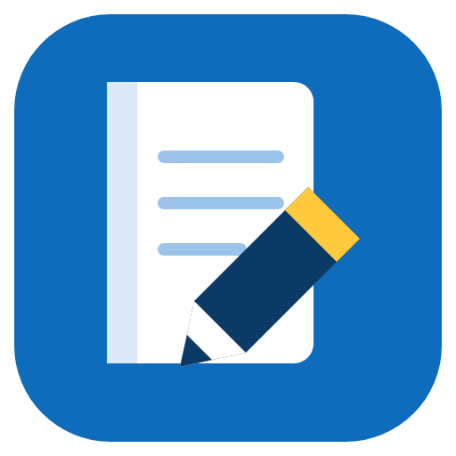
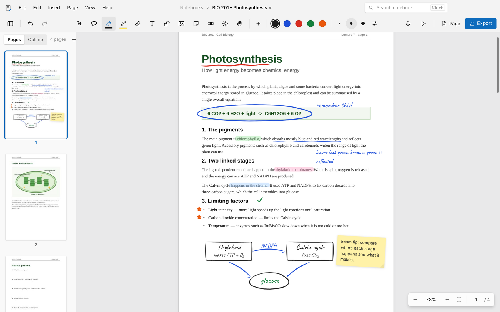
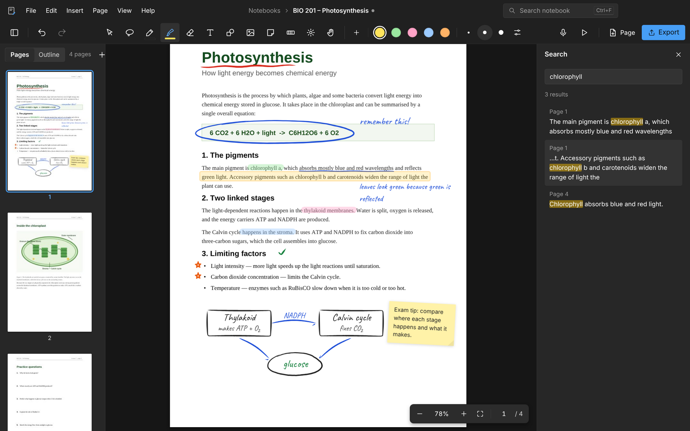
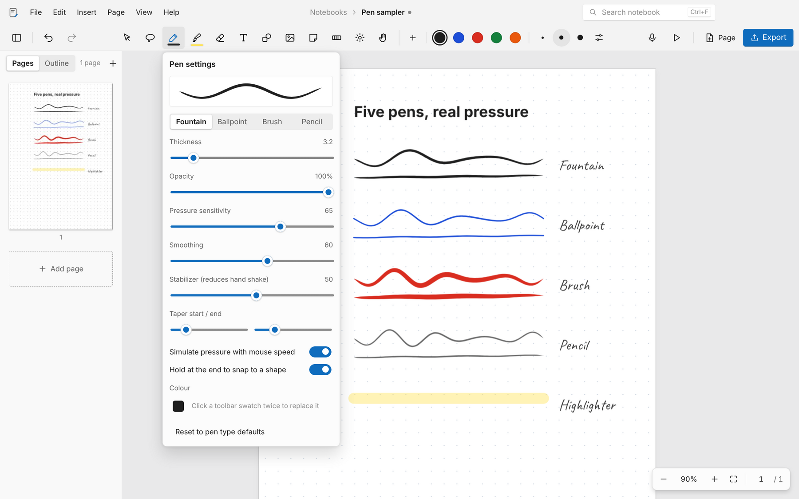
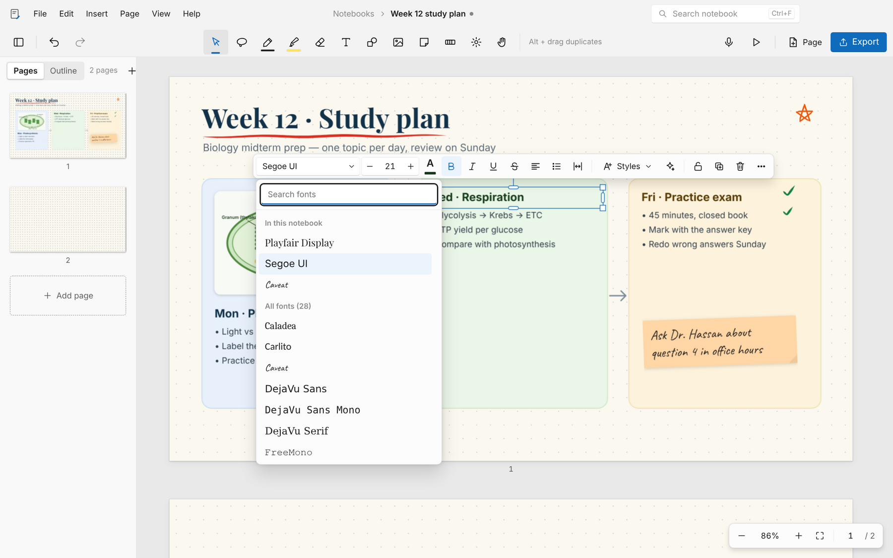
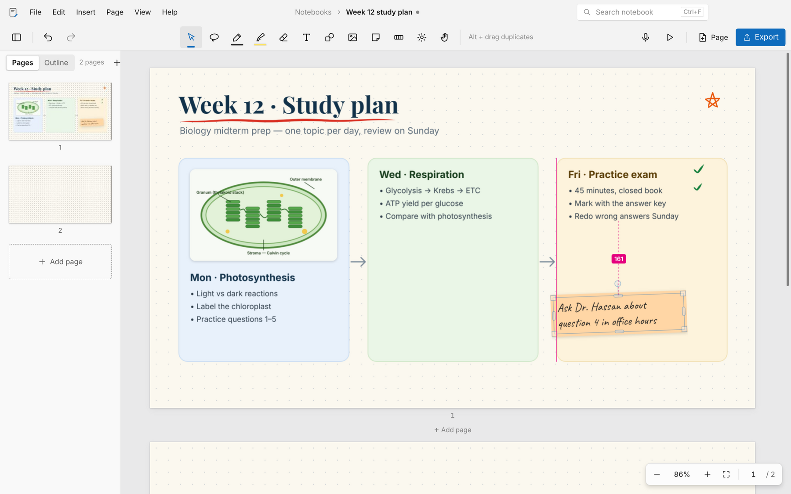
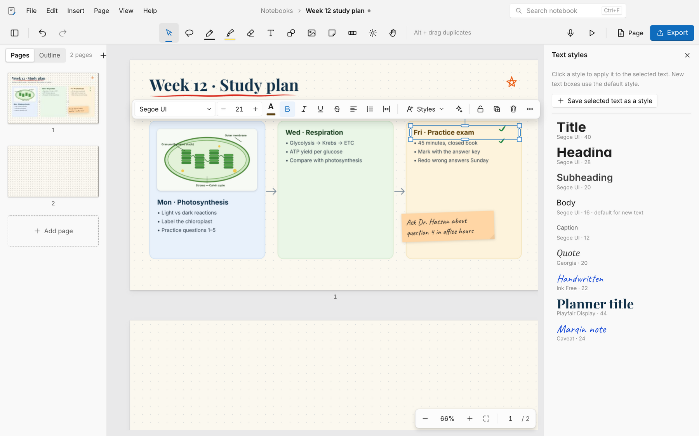
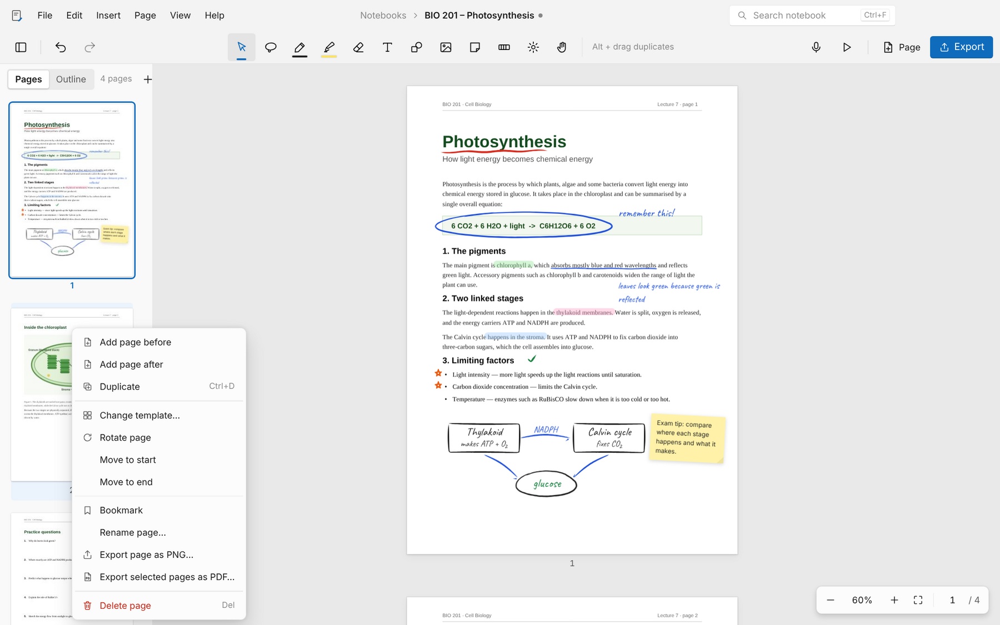
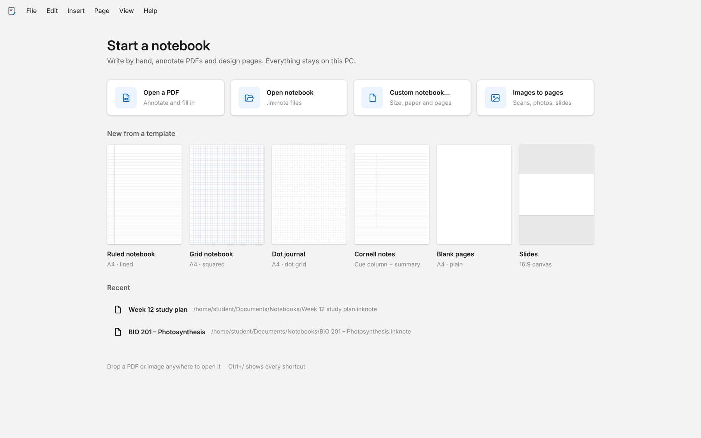

<p align="center">
  
</p>

<h1 align="center">InkNote Studio</h1>

<p align="center">
  <b>The notebook for Windows that writes like paper and designs like Canva.</b><br>
  Annotate PDFs, take handwritten notes with pressure-sensitive pens, and lay out beautiful pages.<br>
  Offline. No account. No subscription.
</p>

<p align="center">
  <a href="https://github.com/Abdelrahman-ahmed-cs/Notebook_App/releases/download/v1.0.0/InkNote.Studio-Setup-1.0.0.exe"></a>
  &nbsp;
  <a href="https://github.com/Abdelrahman-ahmed-cs/Notebook_App/releases/download/v1.0.0/InkNote.Studio-Portable-1.0.0.exe"></a>
</p>

<p align="center">
  Windows 10 and 11 · 64-bit · version 1.0.0 · <a href="https://github.com/Abdelrahman-ahmed-cs/Notebook_App/releases">all releases</a>
</p>

<p align="center">
  
</p>

---

## Why InkNote Studio

- **Yours, forever.** No sign-in, no cloud, no monthly fee. The app blocks all network access, so your notes never leave your PC.
- **Built for Windows.** A native desktop app with the look of Windows 11, not a web page in a frame. It works with a mouse, a touchpad, a Surface Pen or a Wacom tablet.
- **One app instead of three.** Mark up PDFs like a PDF reader, write by hand like a notebook, and design pages like Canva, all in the same document.
- **Open files.** A notebook is a single `.inknote` file. It's a standard ZIP that holds your original PDFs, images and audio, so nothing is locked in.

---

## Mark up any PDF

Open lecture slides, textbooks, papers or forms and write straight on them.

- **Highlights that snap to the text.** Drag the highlighter across a sentence and it locks onto the line, whole words included. It can also underline or strike through.
- **Circle, underline and annotate** with real pen strokes, then add typed notes in any font.
- **Sticky notes** for comments, plus an **Annotations** list of every note and highlight in the document.
- **Search** across your typed text and the PDF's own text at once (Ctrl+F). Results jump to the exact spot.
- **Pages stay sharp** at any zoom, because PDFs are rendered live rather than as blurry images.

<p align="center">
  
</p>

---

## Write like it's paper

Five pens tuned to feel different: **fountain, ballpoint, brush, pencil and highlighter**.

- **Real pressure** from a stylus, and simulated pressure from mouse speed when you don't have one.
- **Your hand, your settings.** Thickness, opacity, pressure sensitivity, smoothing, a **stabilizer** that irons out hand shake, and tapered stroke ends.
- **Save favourite pens** and recolour the toolbar swatches with your own palette.
- **Draw and hold** at the end of a stroke to snap it into a clean line, rectangle, triangle or ellipse. Hold **Shift** for a straight line.
- **Erase the way you think:** remove whole strokes or only the part you touch, limit the eraser to highlighter only, or simply **scribble over** a mistake.
- **Stylus hardware works:** the eraser end always erases, and the barrel button lassoes.
- **Lasso** handwriting, text or images to move, resize, recolour, duplicate, save as an image, or send to another page.

<p align="center">
  
</p>

---

## Design pages like Canva

Make study plans, posters, worksheets and cover pages without leaving your notebook.

- **Every font on your PC**, previewed in its own typeface, with recently used fonts at the top.
- **Full text control:** size, colour, bold, italic, underline, strikethrough, alignment, bullets and numbering, letter and line spacing, shadow, outline and highlight.
- **Arabic and Hebrew** switch to right-to-left automatically as you type.
- **Floating toolbar** above whatever you select, with the right controls for text, images, shapes or ink.
- **Drag and drop** text presets straight onto the page.

<p align="center">
  
</p>

**Place things exactly.** Pink smart guides snap to the page edges, the centre and other objects, with live distance labels. Alt+drag duplicates, the arrow keys nudge, and the Position panel gives you exact size, angle and layer order.

<p align="center">
  
</p>

**Images and shapes.** Insert, paste or drag in pictures from Explorer, then crop, flip, rotate, round the corners, add a border or shadow, and adjust brightness, contrast and saturation. Rectangles, ellipses, stars, lines and arrows come with fill and outline styles.

---

## Saved text styles

Set up your look once and reuse it everywhere. It comes with Title, Heading, Subheading, Body, Caption, Quote and Handwritten styles, and you can save any text as your own style in one click. Apply a style to a whole box or to just the selected words, and pick which style new text boxes start with.

<p align="center">
  
</p>

---

## Organise your pages

- **Thumbnails** in a resizable sidebar. Drag to reorder, Ctrl or Shift-click to select several, and hover between two pages to insert one right there.
- **Nine paper types:** blank, ruled, narrow ruled, grid, dot grid, isometric, Cornell, music staff and checklist. Pick any paper colour and line spacing, at A3, A4, A5, Letter, Legal, 16:9 or square size.
- **Insert pages from other PDFs** or turn scans and photos into pages.
- **Bookmarks and an outline** that carries over the PDF's own chapters and becomes bookmarks when you export.
- **Undo that behaves:** every action is one step, including adding, deleting and moving pages.

<p align="center">
  
</p>

---

## Study tools

- **Record a lecture while you write.** Every stroke remembers when it was written. Select any note to hear what was being said at that moment, or use **Replay** to watch your notes appear in step with the audio.
- **Study tape** hides answers until you click to reveal them.
- **Present** full screen with a **laser pointer** (F5).
- **Links** jump to another page or a website, and still work in exported PDFs.
- **Elements and signatures:** save anything as a reusable sticker, and draw your signature once to drop it into any form.

---

## Start in seconds

Open a PDF, pick a template or reopen a recent notebook. Dropping a PDF or picture anywhere on the window works too.

<p align="center">
  
</p>

---

## Your work is safe

- **Autosave** every minute for notebooks you've already saved, and **crash recovery** for ones you haven't.
- **Small, faithful PDF exports.** Imported PDF pages keep their original quality, your notes go on top, typed text stays searchable and selectable, and bookmarks and links are kept. An annotated three-page PDF exports in kilobytes, not megabytes.
- **PNG export and printing** for single pages.
- **Light, dark or system theme**, plus an optional dark paper mode for late-night study.

---

## Install

1. Download the **[installer](https://github.com/Abdelrahman-ahmed-cs/Notebook_App/releases/download/v1.0.0/InkNote.Studio-Setup-1.0.0.exe)** (about 100 MB).
2. Run it and choose where to install. It adds Start menu and desktop shortcuts, and `.inknote` files open with the app.
3. The first time, Windows may show *"Windows protected your PC"* because the app isn't digitally signed yet. Click **More info → Run anyway**.

Prefer not to install? Download the **[portable version](https://github.com/Abdelrahman-ahmed-cs/Notebook_App/releases/download/v1.0.0/InkNote.Studio-Portable-1.0.0.exe)** and run it from anywhere, even a USB stick.

## Handy shortcuts

| Tools | | Editing | |
|---|---|---|---|
| Select | `V` | Undo / Redo | `Ctrl+Z` / `Ctrl+Y` |
| Pen / Highlighter / Eraser | `P` / `H` / `E` | Duplicate | `Ctrl+D` or Alt+drag |
| Lasso | `L` | Group / Ungroup | `Ctrl+G` / `Ctrl+Shift+G` |
| Text / Sticky note | `T` / `N` | Copy / paste style | `Ctrl+Alt+C` / `Ctrl+Alt+V` |
| Shapes / Rectangle / Ellipse | `S` / `R` / `C` | Search | `Ctrl+F` |
| Pan | hold `Space` | Zoom | `Ctrl` + mouse wheel |
| Laser pointer | `K` | Present | `F5` |

Press **Ctrl+/** inside the app for the complete list.

## FAQ

**Is it really free?** Yes. It's MIT-licensed, with no trial, no ads and no paid tier.

**Does it need the internet?** No. It runs entirely offline, and the app blocks network requests by design.

**Where are my notes stored?** Wherever you save them, as `.inknote` files. Rename the file to `.zip` and you'll find your original PDFs and images inside.

**Do I need a stylus?** No. Mouse users get simulated pressure, a stabilizer, straight lines with Shift and shape snapping. A stylus adds real pressure and its eraser end.

**Does it work with Arabic?** Yes. System fonts are used, and Arabic or Hebrew text switches to right-to-left automatically.

---

## For developers

```bash
npm install          # installs dependencies and copies the renderer libraries
npm start            # run the app
npm test             # end-to-end smoke test (Playwright + Electron)
npm run dist         # build the installer and portable exe into dist/
```

InkNote Studio is built with Electron, Fabric.js, PDF.js, pdf-lib and perfect-freehand. The app's source is in `src/`. Every push is built and smoke-tested on Windows by GitHub Actions. To publish a release, go to **Actions → Build Windows app → Run workflow** and enter a tag such as `v1.1.0`.

The feature set comes from a study of the leading note-taking, PDF and design apps, including what their users love and what they complain about. See [`docs/research`](docs/research/Feature%20and%20UX%20benchmark.md).

## License

[MIT](LICENSE) © 2026 Abdelrahman Ahmed
